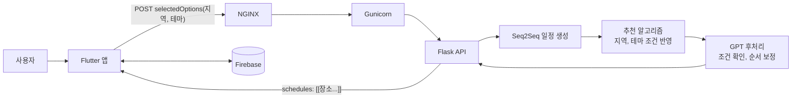
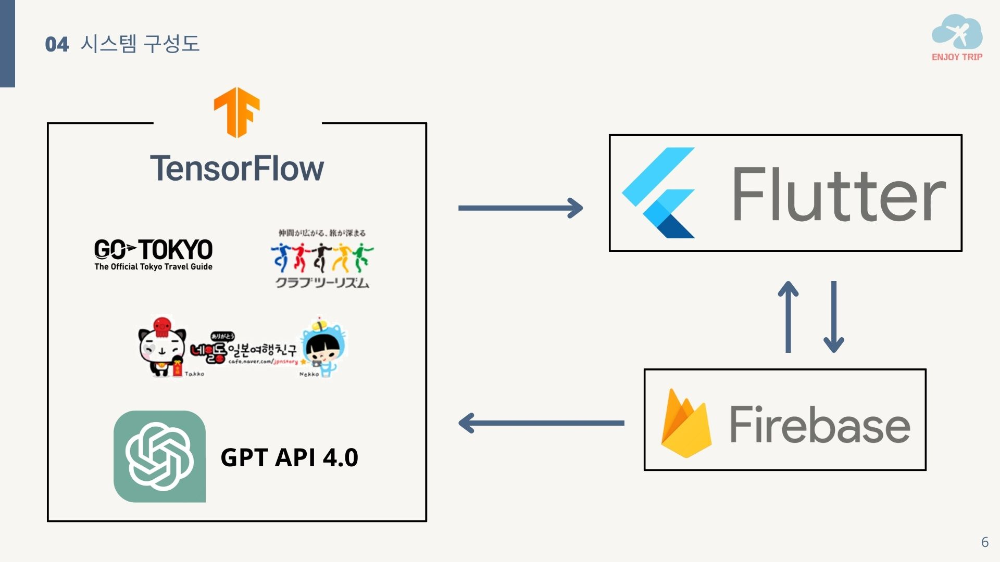
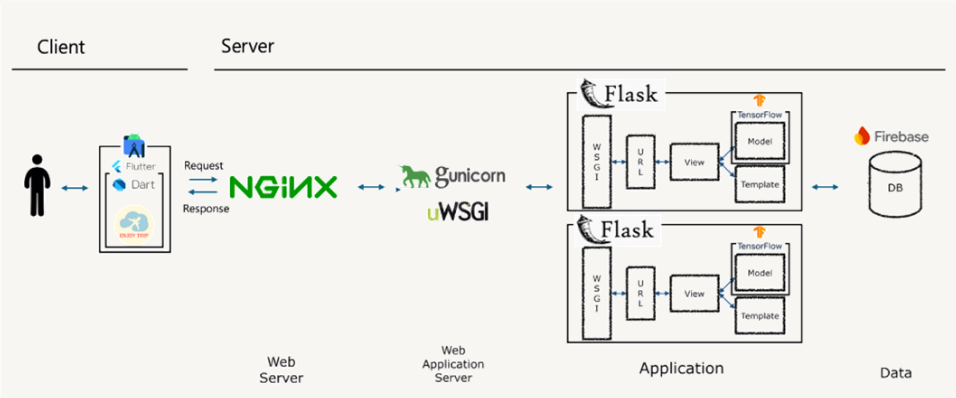
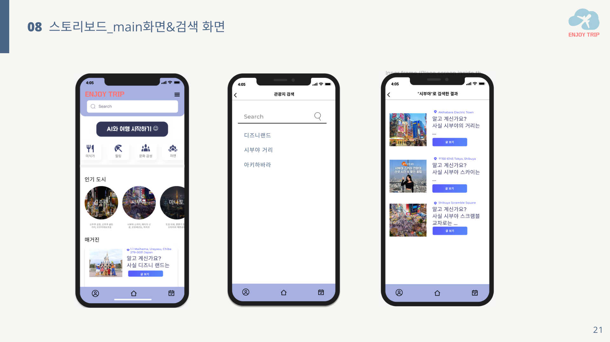
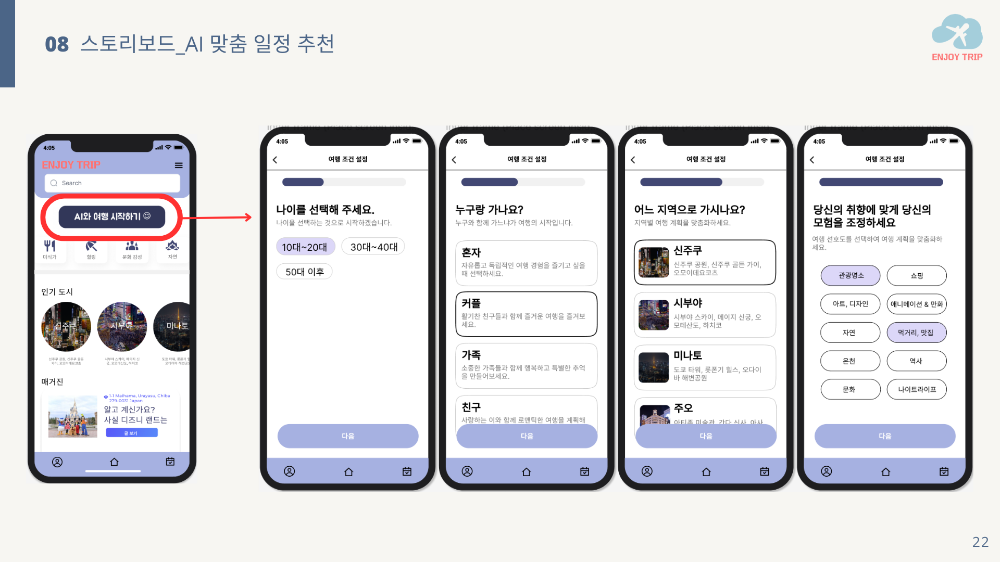
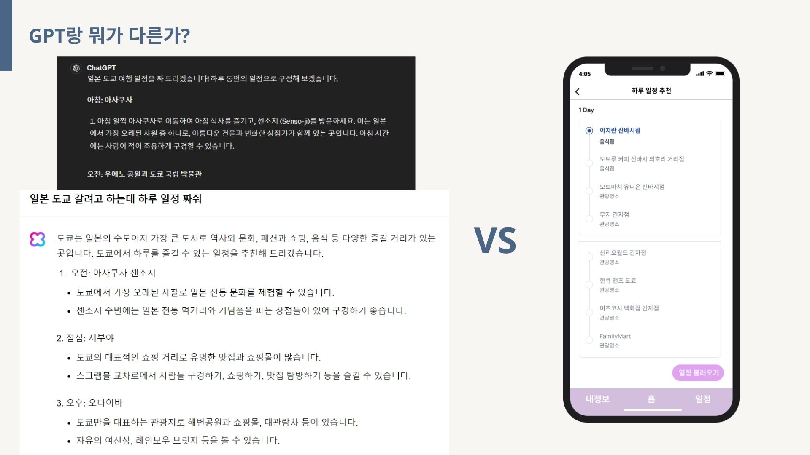

# EnjoyTrip
# EnjoyTrip, AI 자동 여행 플래너 in Tokyo

여행 조건(지역, 테마)을 고르면 도쿄 하루 일정을 자동으로 만들어 주고, 사용자가 직접 고칠 수 있는 모바일 앱입니다. 건양대학교 의료IT공학과와 일본 슈쿠토쿠대학교 관광학과가 함께한 글로벌 캡스톤 디자인 프로젝트입니다.

> 원본 코드 저장소는 남아 있지 않습니다. 이 저장소는 최종보고서, 발표 자료, 보고서 부록에 실린 코드를 정리한 것입니다. 코드 파일마다 출처를 적어 두었습니다.

## 개요

| 항목 | 내용 |
| --- | --- |
| 기간 | 2023.06 \~ 2023.12 (6\~8월 논문 분석과 준비, 9\~12월 구현) |
| 팀 | 7인 (한국 4명, 일본 3명) |
| 내 역할 | AI 모델 담당, 개발 후반 서버 연동과 배포 |
| 기술 | TensorFlow(Seq2Seq), OpenAI GPT, Flask, NGINX, Gunicorn, Flutter(Dart), Firebase |

## 내가 한 일

- 관광지 데이터 전처리와 Seq2Seq 모델 학습 코드 작성, 학습 오류 수정과 결과값 안정화
- 지역과 테마 조건으로 관광지 후보를 고르는 추천 알고리즘을 만들고 Seq2Seq 결과와 결합
- 개발 후반에 일정 AI 결과를 Flask 서버와 연동하고, 연동 과정의 오류 수정과 최종 배포를 맡음

공식 역할 분담은 보고서의 참여인력 표에 있고, 주차별 활동 기록(보고서 3-3)에서 위 작업을 확인할 수 있습니다.

## 구조



앱과 서버가 주고받는 형식은 부록 코드(`code/flutter_app/AIScheduleScreen.dart`)에서 확인할 수 있습니다. 앱은 `{"selectedOptions": ["코토구", "맛집"]}`처럼 조건을 보내고, 서버는 추천 일정 목록 `{"schedules": [[...], [...]]}`을 돌려줍니다.

데이터는 GO TOKYO, 클럽투어리즘, 일본여행 카페(네일동)에서 모은 관광지 정보를 지역, 테마, 관광지 이름으로 정리해 썼습니다.




## 문제와 해결

1. 생성된 일정이 입력 조건과 맞지 않거나 방문 순서가 어색했습니다. 학습 데이터를 다시 구성하고, 조건에 맞는 관광지를 먼저 고르는 추천 알고리즘을 Seq2Seq 앞뒤에 붙였으며, 마지막에 GPT가 조건 충족 여부와 순서를 확인하도록 했습니다.
2. 추천 응답이 느렸습니다. 처음에는 화면(UI)을 고쳤지만 체감 속도가 그대로여서, 단계별 타이머로 구간마다 시간을 재 보니 병목은 데이터 전처리였습니다. 전처리와 데이터셋을 고쳐 해결했습니다.

## 결과

- 개인 테스트 기준, 같은 입력 조건에서 GPT 후처리 전후를 비교했을 때 추천 정확도 약 15%p 향상
- 개인 테스트 기준, 서버 처리 로직 최적화 전후 API 응답 약 25% 단축
- 일본 현지에서 팀원들이 추천 일정을 직접 따라 다니며 사용 테스트, 현지 교수진 긍정 평가

위 두 수치는 당시 개인적으로 측정한 값이고 측정 기록 파일은 남아 있지 않습니다. 보고서의 자체평가표는 팀 단위의 별도 평가입니다.

## 화면





## 폴더

```
code/ai/recommend_excerpt.py   추천 알고리즘 일부 (발표 자료 슬라이드에서 옮김, 내가 작성)
code/flutter_app/*.dart        앱 화면 코드 (보고서 부록 4, 팀 공동 작업)
docs/                          최종보고서 공개용 PDF (개인정보 가림)
images/                        구조도, 화면, 발표 자료
```

## 한계

- Seq2Seq 학습 코드와 Flask 서버 코드는 보고서에 실리지 않아 남아 있지 않습니다.
- 보고서 PDF는 한글 파일을 변환한 것이라 표와 그림 배치가 원본과 다를 수 있습니다.
- 팀원의 이름, 연락처, 학번은 개인정보 보호를 위해 가렸습니다.
